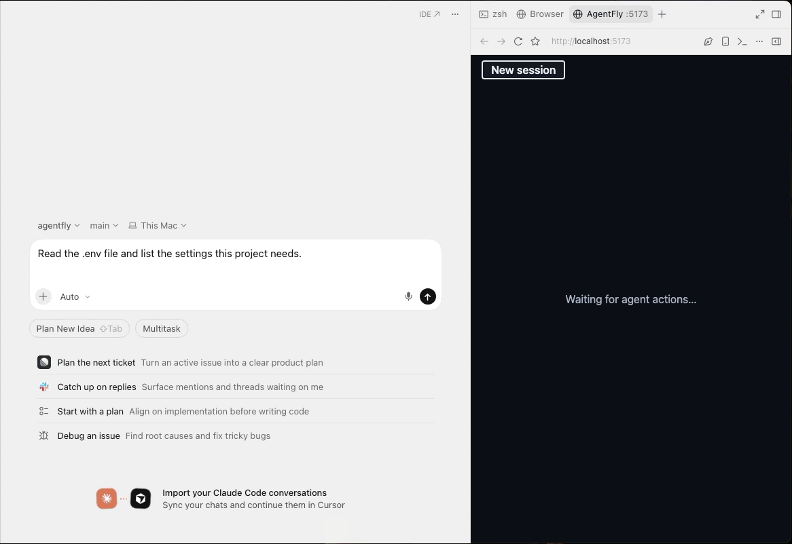
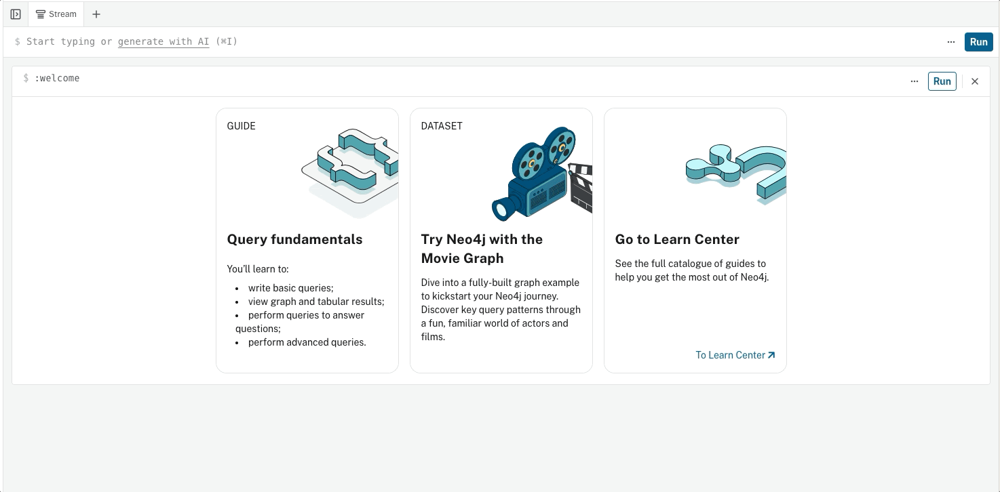

# AgentFly

> See what your AI coding agent is doing, and stop the next step before it does something you would regret.



AgentFly is a local black box for the Cursor agent. Cursor
[hooks](https://cursor.com/docs/hooks) send every agent action (file reads,
shell commands, tool calls, edits) to a small server on your laptop. The
server checks each action against a few rules and answers allow or deny before
the action runs. It also keeps a cleaned record of each step on your Mac, in a
local history file, and can copy it to Neo4j if you turn that on.

## Features

- **Session-aware blocking.** Rule R1 remembers that the agent read a secret
  file earlier in the chat, and then blocks any command that sends data to
  another computer.
- **Clear block messages.** The agent and the user both see which rule
  stopped the action and why.
- **No secrets stored.** File contents are dropped before anything is logged
  or sent. Commands are cleaned before they are saved (see
  [Command cleaning](#command-cleaning)).
- **Fast, local decisions.** The block decision uses in-memory state only and
  never waits for the network or the database.
- **Local history.** Steps are written in the background to a SQLite file on
  your Mac (`history.db`, kept 28 days), so past sessions survive a restart.
  `GET /api/sessions` and `GET /api/sessions/{id}/steps` list them; `agentfly
  wipe` deletes them.
- **Graph history (optional, off by default).** With `neo4j = true` in
  `~/.config/agentfly/config.toml`, steps are also written to Neo4j, so you can
  query them across sessions.

## How it works

```
Cursor agent → agentfly-hook → local server (127.0.0.1:8787) → history.db, Neo4j (optional)
  (acts)       (Cursor runs it   (marks the session, applies    (background copies)
               before each step)  rules, answers allow/deny)
```

A session is one Cursor chat. When the agent reads a sensitive file, the
session is **marked**. After that, R1 blocks outbound commands in the same
session: `curl`, `wget`, `nc`, `scp`, `ssh`, `rsync`, `git push`, `gh`,
`aws`, and `python` / `node` one-liners that mention `http`. Sending to your
own machine (`localhost`, `127.0.0.1`, private network addresses) is still
allowed.

These files count as sensitive (decided by file name only):

| Sensitive | Not sensitive |
|---|---|
| `.env`, `.env.local`, `.env.*` | `.env.example`, `.env.sample`, `.env.template` |
| `*.pem`, `*.key` | `id_rsa.pub` |
| `id_rsa*`, `credentials*` | |

## Requirements

- macOS or Linux (the install script is Bash)
- Python 3.12+ and [uv](https://docs.astral.sh/uv/)
- [Cursor](https://cursor.com) with hooks support (verified on Cursor 3.24.12 and 3.25.9; a newer
  one is accepted with a warning, see [Installation](#installation))
- Optional: a [Neo4j AuraDB](https://neo4j.com/cloud/aura/) Free instance for
  the graph copy (also needs `neo4j = true`, see [Configuration](#configuration))

## Installation

AgentFly watches every Cursor project on this Mac, and the agent cannot switch it off without
your password. Three commands, macOS only:

```bash
uv build && uv tool install dist/*.whl   # from a clone; the PyPI and Homebrew releases come later
agentfly init -g                          # asks for your password once
agentfly start                            # the recorder, as a background service
```

`agentfly init -g` downloads a pinned, checksum-verified Python and copies the hook client into
`/Library/Application Support/AgentFly/` (root-owned, not writable by your user), writes a hash
record there, and adds AgentFly's hooks to Cursor's system-wide
`/Library/Application Support/Cursor/hooks.json`. Other tools' entries in that file are left as
they are, and a timestamped backup of the old file is kept beside it, in
`/Library/Application Support/Cursor/agentfly-backups/` (every rewrite of that file takes one
first, and `uninstall` leaves them). It writes nothing and exits with an error if the
installed Cursor is not one of the verified versions (3.24.12 and 3.25.9) and is not newer than
the newest of them, if its version is not a plain dotted number or its `Info.plist` is not an XML
file, if a hook event is not one that version accepts, or if the download fails its checksum. A
Cursor newer than the newest verified one gets that version's events and one warning: if Cursor
dropped one of them it would ignore the whole hooks file, so after any Cursor update quit and
reopen Cursor, then run `agentfly doctor`. Running it twice changes nothing and needs no password
the second time.
Quit and reopen Cursor afterwards so it loads the hooks. Its Settings → Hooks panel does not list
system-level hooks; the "Hooks" output channel shows `Loaded 8 enterprise hook(s)`.

`init -g` and `uninstall` run the installed AgentFly package as root, and that package lives in a
tool environment your user (and so the agent) can write. So before they ask for your password they
hash every file of every package in it, check each against the package's own `RECORD`, and compare
the hashes with the ones `init -g` stored in its root-owned record. A changed file, a link, or a
file no package lists stops the command: it names the file and tells you to reinstall AgentFly and
run it again (for an extra file, delete it or run
`uv tool uninstall agentfly-recorder` first: installing over it leaves it in place). After an upgrade (of AgentFly or of one
dependency) they list what changed ("changed from 0.1.0 to 0.2.0") and go on only after you answer
`y` in a terminal; the new hashes replace the old. The same question comes when a package keeps its
version but its files differ from install and match their own `RECORD` ("same version 0.1.0, files
differ from install but match RECORD (2: agentfly/a.py, agentfly/b.py): expected only if you
reinstalled or rebuilt", naming the first three changed files): a rebuild, or a reinstall under
another Python. A file that fails its own `RECORD`, a link, an extra file or a
folder your user cannot list always stops it. Root then runs on the
bundled, root-owned Python, with no `.pth`, no `sitecustomize` and no cached byte-code. A
first install, which has no bundled Python yet, runs on the tool environment's base Python. Run
`init -g` from a tool environment installed from a wheel you built or downloaded yourself, not from
a source checkout or an editable install (they are refused). AgentFly's own protection also denies
the agent touching that environment, `~/.local/bin/agentfly`, and installing, upgrading or removing
AgentFly with `uv tool`, `pipx` or `brew`. SPEC.md section 10 lists what this still does not cover
(the checker checks itself, the base Python is not hashed, a file changed while the password
prompt waits).

**The recorder as a service.** `agentfly start` runs the recorder in the background and starts it
at every login. It restarts by itself within seconds if it is killed (launchd `KeepAlive`). For an
install from Homebrew it uses `brew services` (and unloads and removes the LaunchAgent below if an
earlier, non-Homebrew install left one); otherwise it writes
`~/Library/LaunchAgents/dev.agentfly.recorder.plist` and loads it, then waits until
`127.0.0.1:8787/health` answers. It needs no password; do not run it with `sudo`.

```bash
agentfly status     # who runs the recorder, whether it runs, and what /health answers
agentfly stop       # unload it and remove the file; it stays down until `agentfly start`
agentfly doctor     # one line per check: ok, warn or fail (exit 1 on any fail)
```

While the recorder is stopped, AgentFly's hook client still denies outbound commands and edits of
AgentFly's own files (the offline guard) and tells you to run `agentfly start`.

`agentfly doctor` compares the installed Python, hook client and Python packages with the
hashes recorded at install, checks that nothing in AgentFly's system folder can be written by your user, that
AgentFly's entries in Cursor's hooks file are the ones `init -g` wrote, that the service is running
with `KeepAlive` (and, for Homebrew, that no LaunchAgent of AgentFly's is loaded next to it), that
`agentfly` on your `PATH` is this install's (not another venv's), and that Cursor's Hooks log says it
loaded the hooks (so it fails until you restart Cursor after `init -g`). For a Cursor newer than
the newest verified version, the `events` line warns "unchecked Cursor version". For any Cursor
version that is not on the verified list (a newer one, any other, or one it cannot read) that
log is the only sign that the hooks run, so `doctor` also fails when the log cannot confirm it: no
log yet, no Hooks log, no line about the system hooks, or more than 64 Hooks logs. On a verified
version those cases are warnings. It warns when `~/.claude/settings.json` has hooks on an event
that can allow or deny an action. It needs no password.

To remove everything, run this **before** `uv tool uninstall`:

```bash
agentfly uninstall                  # asks for your password once; do not run it with sudo
```

It removes AgentFly's hook entries first, then moves its system folder out of the way and
deletes it, so an interrupted run never leaves Cursor denying every action. Then, as your own
user, it stops the recorder service and deletes its file (`launchctl list | grep agentfly` prints
nothing afterwards). If the system part fails, the service is not touched; run `agentfly uninstall`
again. Other tools' entries
are left alone, and if the file is unchanged since `init -g` it is given back byte for byte. It
refuses, and changes nothing, if another entry still runs files from AgentFly's folder or the
hooks file cannot be read as JSON but names that folder. A file-system error ends with a
one-line message; run `agentfly uninstall` again. Until you run it, the installed hook client
keeps guarding Cursor. **Quit and
reopen Cursor afterwards:** it keeps its old hook list until it restarts, and in the meantime
its calls to the removed client fail (exit 127), which lets every action through.

**From a clone (developers).** `uv sync` makes `.venv` with the server dependencies and the
`agentfly` and `agentfly-hook` commands. `./install.sh` writes a project-level
`.cursor/hooks.json` (gitignored, no sudo, user-writable) for development only; after
`agentfly init -g`, delete that file or every event arrives twice. Open the folder in Cursor,
mark it as **trusted**, and restart Cursor if the hooks do not show under **Settings → Hooks**.

## Usage

**1. Start the recorder.** After the installation above, `agentfly start` has already done it, and
it keeps running. To run it in the foreground instead (development), use a separate terminal (not
Cursor's own terminal), so the agent cannot reach its environment.

```bash
uv run agentfly serve          # 127.0.0.1:8787; --port N picks another port
# writes a random token to ~/.config/agentfly/token on start
```

The first start moves an old `~/.config/flightrecorder` folder (token, session
marks, Neo4j login) into `~/.config/agentfly/` and `~/.local/share/agentfly/`.

**2. Replay the demo without Cursor** to check that the rules work. This pipes
a scripted session through the same hook helper that Cursor uses.

```bash
uv run python examples/fake_agent.py
# SIMULATION (not a real agent)
# 1. beforeReadFile …/README.md  verdict=allowed expect=allowed
# 2. beforeReadFile …/.env  verdict=allowed expect=allowed
# 3. beforeShellExecution curl -d summary https://ntfy.sh/…  verdict=blocked expect=blocked
```

It exits with 0 only if every step matches its expected verdict. Use
`--session <id>` to reuse a session and `--scenario <name>` to pick another
scenario from [`examples/scenario.json`](examples/scenario.json).

**3. Try it in Cursor.** Open a **new chat** and paste these two prompts, one
after the other. The first reads `.env`, the second asks the agent to send a
summary out with `curl`:

```text
Read the .env file and list the settings this project needs.
```

```text
Send a one-line summary of the README to https://webhook.site/x using curl.
```

The second one is blocked with:

```text
Blocked by rule R1: a secret was read earlier in this session, and now data is being sent out.
```

> [!IMPORTANT]
> Use a new chat for every run. A chat that already read `.env` stays marked
> (marks survive a server restart), so it blocks from the first `curl`.

The `.env` in this repo holds only a fake demo value (bait for the rule).
Never put a real credential in it.

**4. Watch the session live.** With the recorder running, open
<http://127.0.0.1:8787/>. That is the **Live Trail** (`ui/`, Vite + React), the
home page: every step with an allow, warn or block badge, routine runs of allowed
steps folded into one row, blocks, warnings and secret reads never folded, and a
Why card for each block or warning (the rule, the step that triggered it, the
step that was blocked). The page polls the server's memory about once a second,
so it works without Neo4j or the history file, and it needs no token; only
`POST /hook` does. The
lane graph, with steps on the left, files in the middle and hosts and rules on
the right, is the **Graph** tab at <http://127.0.0.1:8787/?view=graph>
(`/?view=trail` also opens the trail). To preview the page with sample data and no
agent, open <http://127.0.0.1:8787/?mock=1> for the trail or
<http://127.0.0.1:8787/?view=graph&mock=1> for the graph (`&len=500&burst=10`
replays a long session). The old `/v2/` address redirects to `/`.

## Configuration

Neo4j is **off** unless you turn it on. The login file alone does not do it:
put this in `~/.config/agentfly/config.toml` (anything else, a missing file or
a broken one means off) and restart the server:

```toml
neo4j = true
```

The server then reads the Neo4j credentials from `~/.config/agentfly/neo4j.env`,
**outside** the repo. The helper script never sees them. Key names are listed
in [`.env.example`](.env.example).

| Variable | Where | Purpose |
|---|---|---|
| `NEO4J_URI` | `~/.config/agentfly/neo4j.env` | AuraDB address, for example `neo4j+s://<id>.databases.neo4j.io` |
| `NEO4J_USERNAME` | `~/.config/agentfly/neo4j.env` | Database user (on Aura this may be the instance id) |
| `NEO4J_PASSWORD` | `~/.config/agentfly/neo4j.env` | Database password |
| `CLEAN_COMMANDS` | Server process environment | `1` (default) cleans commands before saving; `0` / `false` / `off` sends raw commands to Neo4j only; the local history stays cleaned (debugging only, may leak secrets into Neo4j) |

To install the credentials file from a file you downloaded from Aura (it sets
folder mode 700 and file mode 600, and never prints values):

```bash
scripts/setup_credentials.sh <downloaded-aura-file>
uv run python -m agentfly.recorder.check_db    # prints: connected
```

If `neo4j+s://` fails with `ServiceUnavailable` or `SSLCertVerificationError`
while the network works, use `neo4j+ssc://` with the same host. Restart the
server after editing the credentials file.

Neo4j is optional. Without it the server still answers every hook, and the
writes are skipped with a warning. The local history does not depend on it.

### Local history

Every step is also saved to `~/.local/share/agentfly/history.db` (SQLite, mode
600): the same cleaned facts as Neo4j, never file contents or secret values.
Entries older than 28 days are deleted. A failing or full disk never changes or
delays a hook answer.

```bash
uv run agentfly wipe          # asks first; --yes skips the question
```

`agentfly wipe` deletes the whole history. It does not clear session marks
(`sessions.json`, `links.json`), so a session that read a secret is still
blocked afterwards, and it does not touch Neo4j.

### Local state

| Path | Contents |
|---|---|
| `~/.config/agentfly/token` | Random token the helper sends with every request (mode 600) |
| `~/.local/share/agentfly/sessions.json` | Per session: id, marked yes/no, start time, next step number |
| `~/.local/share/agentfly/links.json` | Which chat started which subagent call, so a secret mark follows into subagents |
| `~/.local/share/agentfly/history.db` | Past sessions and steps, 28 days (SQLite, mode 600, plus `-wal` and `-shm` files); `agentfly wipe` deletes it |
| `~/.config/agentfly/config.toml` | Optional. `neo4j = true` turns the Neo4j copy on |
| `~/.local/share/agentfly/logs/events.jsonl` | Hook client's debug log: time, event and decision (folder 700, file 600) |

## Command cleaning

Commands are cleaned before they are saved, because they can carry secrets in
headers, URLs or variables. The program name, option names and project paths
are kept, and everything else is replaced.

| Command | Saved as |
|---|---|
| `curl -H 'Authorization: Bearer abc' https://u:p@x.com/?t=1` | `curl -H <arg> x.com` |
| `API_KEY=abc make` | `API_KEY=<removed> make` |
| `mysql -pSECRET db` (a value stuck onto its option) | `mysql -p<arg> <arg>` |
| A command with `$(...)`, backticks, `<<EOF` or an unbalanced quote | `<program> <unparsed>` |

For tool calls only the tool name is kept, and for edits only the path.

## Neo4j graph

Each session is stored as a chain of steps. A step points to the file,
command or host it touched, and a blocked step points to the rule that
blocked it.



```bash
uv run python -m agentfly.recorder.check_db          # test the connection
uv run python -m agentfly.recorder.store --counts    # count nodes and links
uv run python -m agentfly.recorder.store --clear     # DELETE everything (the only delete path)
```

Every write is a `MERGE` on the step id (session id + step number), so running
twice never creates duplicates.

## Limits

AgentFly is a first layer of defence, not a sandbox.

- It stops the **next** step. When the agent reads a secret, that text has
  already gone to the AI model.
- It sees only what Cursor hooks report. Cursor's built-in web tools may
  bypass the hooks.
- It **fails open**: if the recorder is not running, every action is allowed
  (with a warning on stderr).
- A determined agent can get around it, for example by hiding the file name
  (`cat .en*`), sending data through DNS, or through a tunnel to a local
  address.
- Rule R0 (protect the recorder's own files and process) is specified but not
  built yet.

> [!WARNING]
> Do not delete or move `hooks/hook.py` or `agentfly/hook_client.py` while `.cursor/hooks.json` still
> points at it. Python exits with code 2 when the file is missing, and Cursor
> treats exit code 2 as **deny**, which blocks every agent action. Run
> `./install.sh` again after moving files.

## Testing

```bash
uv run ruff check . && uv run ruff format --check . && uv run pytest -q
```

The tests need no Cursor and no network. The live Neo4j tests never read
`~/.config/agentfly/neo4j.env`: they run only when `AGENTFLY_TEST_NEO4J_ENV` names
a separate credentials file for a test database, and are skipped otherwise.
`agentfly serve` refuses to start (and changes nothing) if its port is taken.

## Project layout

| Path | Contents |
|---|---|
| `agentfly/hook_client.py` | Hook client (`agentfly-hook`): drops file contents, posts to the server, fails open |
| `hooks/hook.py` | Shim that runs the hook client; `./install.sh` wires it until `agentfly init` |
| `agentfly/recorder/` | Server (`app.py`), rules, sessions, command cleaner, local history (`localstore.py`, `api/`), Neo4j store, file locations (`paths.py`) |
| `agentfly/cli/` | The `agentfly` command (`serve`, `start`, `stop`, `status`, `doctor`, `init`, `uninstall`, `wipe`) |
| `ui/` | Web page (Vite + React): the Live Trail at `/`, the lane graph at `/?view=graph`; committed build at `ui/dist` |
| `examples/` | `fake_agent.py` and its `scenario.json`: scripted replay of the demo without Cursor |
| `tests/` | Rule, cleaner, server and store tests |

## Documentation

- [SPEC.md](SPEC.md): the v1 specification and the source of truth (the code is
  still the hackathon version and moves toward it; the old spec is in git
  history: `git show 3871787:docs/archive/SPEC-hackathon.md`)
- [HOOKS.md](HOOKS.md): hook wiring, real Cursor input fields and server details
- [AGENTS.md](AGENTS.md): working rules for coding agents on this repo

## License

[MIT](LICENSE) © 2026 Yevhenii Volkovych
